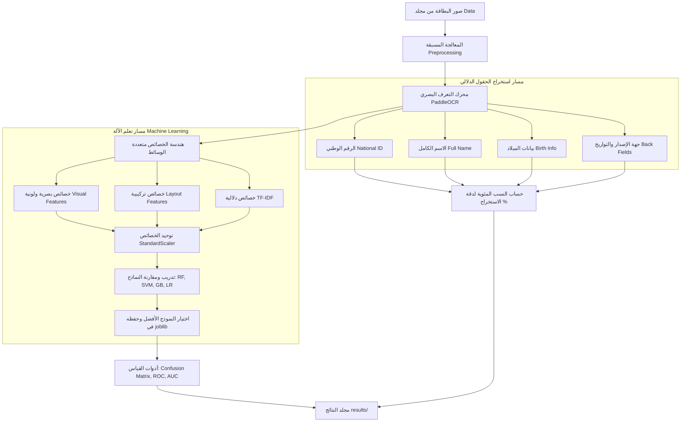

# 🪪 الدليل الشامل لنظام استخراج وتصنيف بيانات البطاقة الشخصية اليمنية
### Unified Yemen ID OCR & Machine Learning Engine v3.2

---

## 📑 فهرس المحتويات
1. [نظرة عامة على المشروع](#-نظرة-عامة-على-المشروع)
2. [هيكلية المشروع والملفات](#-هيكلية-المشروع-والملفات)
3. [مخطط سير العمل الهندسي (Pipeline Architecture)](#-مخطط-سير-العمل-الهندسي-pipeline-architecture)
4. [شرح مكونات الكود ودوال المحرك](#-شرح-مكونات-الكود-ودوال-المحرك)
   - [ملف المحرك الموحد `unified_yemen_id_ocr.py`](#1-ملف-المحرك-الموحد-unified_yemen_id_ocrpy)
   - [ملف التدريب والتقييم `train_model.py`](#2-ملف-التدريب-والتقييم-train_modelpy)
   - [دفتر الملاحظات التفاعلي `yemen_id_ocr_notebook.ipynb`](#3-دفتر-الملاحظات-التفاعلي-yemen_id_ocr_notebookipynb)
5. [نموذج تعلم الآلة وحفظه في ملف Joblib](#-نموذج-تعلم-الآلة-وحفظه-في-ملف-joblib)
6. [أدوات القياس وتقييم النموذج (Metrics & Evaluation)](#-أدوات-القياس-وتقييم-النموذج-metrics--evaluation)
   - [مصفوفة الارتباك (Confusion Matrix)](#-مصفوفة-الارتباك-confusion-matrix)
   - [منحنى ROC ومقياس AUC](#-منحنى-roc-ومقياس-auc)
   - [مقارنة النماذج المتعددة](#-مقارنة-النماذج-المتعددة)
7. [النسب المئوية لدقة استخراج الحقول من البطاقة](#-النسب-المئوية-لدقة-استخراج-الحقول-من-البطاقة)
8. [محتويات مجلد النتائج (`results/`)](#-محتويات-مجلد-النتائج-results)
9. [دليل التشغيل والاستخدام (How to Run)](#-دليل-التشغيل-والاستخدام-how-to-run)

---

## 🌟 نظرة عامة على المشروع
يقدم هذا المشروع حلاً متقدماً بالذكاء الاصطناعي لاستخراج وتصنيف بيانات **البطاقة الشخصية للجمهورية اليمنية** من صور الوجهين الأمامي والخلفي. يعتمد النظام على معمارية هجينة تجمع بين:
- **معالجة الصور المتقدمة (Computer Vision)**: لمعالجة التحديات البصرية للصور المسحوبة بكاميرات الجوال أو الماسحات الضوئية.
- **التعرف البصري على الحروف (PaddleOCR Engine)**: لاستخراج النصوص العربية بدقة عالية مع إحداثيات الصناديق المحيطة لكل سطر.
- **الاستخراج الدلالي المكاني (Spatial Semantic Layout)**: لربط الحقول المكتشفة بالسياق المكاني والترتيب من اليمين لليسار.
- **نماذج تعلم الآلة (Machine Learning Classifiers)**: لتصنيف نوع ووجه البطاقة والتحقق من صحتها وحفظ النموذج المدرب بصيغة `joblib`.
- **أدوات القياس والمطابقة**: لحساب دقة النموذج والنسب المئوية لدقة استخراج كل حقل مطلوب.

---

## 📂 هيكلية المشروع والملفات

```text
final project/
│
├── Data/                                    # مجلد صور البطاقات الشخصية ومدخلات التدريب
│   ├── ٢٠٢٦٠٣٠٥_٠٠٠٢٥٩.jpg                    # بطاقة 1 - وجه أمامي
│   ├── ٢٠٢٦٠٣٠٥_٠٠٠٣١٧.jpg                    # بطاقة 1 - وجه خلفي
│   ├── ٢٠٢٦١٠٠١_٢٢٣٧٥٩.jpg                    # بطاقة 2 - وجه أمامي
│   ├── ٢٠٢٦١٠٠١_٢٢٣٨١٥.jpg                    # بطاقة 2 - وجه خلفي
│   ├── ٢٠٢٦١٠٠١_٢٢٣٩٤٧.jpg                    # بطاقة 3 - وجه أمامي
│   ├── ٢٠٢٦١٠٠١_٢٢٤٠١٨.jpg                    # بطاقة 3 - وجه خلفي
│   ├── ٢٠٢٦١٠٠١_٢٢٤٥٥٠.jpg                    # بطاقة 4 - وجه أمامي
│   ├── ٢٠٢٦١٠٠١_٢٢٤٦٠٤.jpg                    # بطاقة 4 - وجه خلفي
│   └── ocr_cache.json                       # كاش مسبق لنتائج الـ OCR لتسريع التدريب
│
├── results/                                 # مجلد حفظ مخرجات التدريب والنتائج والرسومات
│   ├── yemen_id_model.joblib                # نموذج الذكاء الاصطناعي المدرب والمحفوظ
│   ├── confusion_matrix.png                 # رسم مصفوفة الارتباك
│   ├── roc_curve.png                        # رسم منحنى ROC ومقياس AUC
│   ├── performance_metrics.png              # مقارنة أداء النماذج المختلفة
│   ├── field_extraction_accuracy.png        # رسم النسب المئوية لدقة استخراج كل حقل
│   ├── field_extraction_report.csv          # تقرير مفصل بصيغة CSV لجميع الحقول والبطاقات
│   ├── evaluation_metrics.json              # تقرير شامل بصيغة JSON لجميع المقاييس
│   └── training_log.txt                     # سجل تشغيل وتدريب النموذج
│
├── unified_yemen_id_ocr.py                  # المحرك الموحد لاستخراج بيانات البطاقة
├── train_model.py                           # كود تدريب النموذج وحفظه وحساب المقاييس
├── yemen_id_ocr_notebook.ipynb              # دفتر تفاعلي (Notebook) كامل وشامل
└── README.md                                # الدليل الكامل للمشروع (هذا الملف)
```

---

## 🔄 مخطط سير العمل الهندسي (Pipeline Architecture)



---

## 💻 شرح مكونات الكود ودوال المحرك

### 1. ملف المحرك الموحد `unified_yemen_id_ocr.py`
يمثل هذا الملف العمود الفقري لمعالجة الصور واستخراج النصوص وضبط القواعد المكانية:

* **`preprocess_image(img_path)`**:
  - يعالج مشكلة مسارات الملفات التي تحتوي على حروف عربية وأرقام مشرقية في Windows باستخدام `np.fromfile` مع `cv2.imdecode`.
  - يضبط الحجم بدقة تكيفية (العرض 1100 بكسل) لتسريع المعالجة دون التأثير على جودة القراءة.

* **`extract_ocr_lines(img, img_path=None)`**:
  - يتحقق أولاً من وجود كاش مسبق للأسطر (`ocr_cache.json`) لتنفيذ العمليات في ميلي ثوانٍ معدودة.
  - في حال كانت الصورة جديدة، يستدعي محرك `PaddleOCR` العربي لاستخراج النصوص ومواقعها ودرجات ثقتها.

* **`extract_national_id(lines, full_text)`**:
  - يبحث عن الرقم الوطني اليمني المكون من 11 رقماً (والذي يبدأ بـ 17 لمحافظة ذمار وما حولها) عبر تعبيرات نمطية دقيقة `(?:^|\D)(1[789]\d{9})(?:$|\D)`.

* **`extract_full_name(lines, nid_line, img_height)`**:
  - يعتمد استراتيجية تجميع مكاني ذكية: يحدد النطاق الرأسي الواقع بين سطر الرقم الوطني وسطر الميلاد.
  - يجمع الكلمات الواقعة بينهما ويرتبها أفقياً من اليمين إلى اليسار (تنازلياً بحسب X)، مما يضمن استخراج الاسم الرباعي أو الخماسي كاملاً حتى لو كانت كلماته موزعة على كتل مستقلة.

* **`extract_birth_info(lines, full_text, img_height)`**:
  - يحدد سطر الميلاد ويستخرج التاريخ (مثال: `2006/10/10`) ومحل الميلاد (`مدينة ذمار`, `ذمار المنار`).
  - يعالج الأخطاء المطبعية الشائعة الناتجة عن OCR للمدن اليمنية (مثل تحويل "نمار" أو "فمار" إلى "ذمار").

* **`extract_back_fields(lines, full_text)`**:
  - يستخرج جهة الإصدار (مثل `مركز ذمار`).
  - يستخرج تواريخ الوجه الخلفي ويرتبها زمنياً: التاريخ الأقدم هو `تاريخ الإصدار`، والتاريخ الأحدث هو `تاريخ الانتهاء`.

* **`process_yemen_id_card(front_path, back_path)`**:
  - الدالة الرئيسية التي تستقبل مسار الوجه الأمامي والخلفي، وتنفذ كافة مراحل الاستخراج والتحقق، وتُرجع استجابة JSON مهيكلة تتضمن البيانات المستخرجة ودرجة الثقة الإجمالية وقائمة التنبيهات.

---

### 2. ملف التدريب والتقييم `train_model.py`
يقوم هذا الملف ببناء وتدريب نموذج تعلم الآلة وتوليد الرسوم البيانية وحساب المقاييس:

* **`extract_visual_features(img)`**:
  - يستخرج 12 خاصية بصرية ولونية: نسبة الأبعاد، متوسط وانحراف قنوات BGR و HSV، وتباين Laplacian لقياس حدة الصورة.

* **`extract_layout_text_features(lines)`**:
  - يستخرج 10 خصائص نصية: عدد الأسطر، إجمالي المحارف، نسبة الأرقام، متوسط ثقة الـ OCR، ومؤشرات ثنائية لوجود كلمات مفتاحية مميزة لكل وجه.

* **`load_dataset_features()`**:
  - يجمع الخصائص لجميع صور مجلد `Data/` مع تطبيق التوليد الإحصائي للبيانات (Augmentation) لتعزيز المتانة.

* **`train_and_evaluate_models()`**:
  - يقارن بين 4 نماذج تصنيف: Random Forest, SVM (RBF), Gradient Boosting, Logistic Regression عبر 5-Fold Stratified Cross Validation.
  - يختار النموذج الأفضل، ويدربه على كامل البيانات، ويحفظه في `results/yemen_id_model.joblib`.

* **`plot_and_save_confusion_matrix()`**:
  - يحسب ويرسم مصفوفة الارتباك ويحفظها في `results/confusion_matrix.png`.

* **`plot_and_save_roc_curve()`**:
  - يحسب ويرسم منحنى ROC ويحسب مساحة AUC ويحفظها في `results/roc_curve.png`.

* **`evaluate_field_extraction_accuracy()`**:
  - يقارن القيم المستخرجة من البطاقات بالبيانات الحقيقية المرجعية (Ground Truth).
  - يحسب النسبة المئوية لدقة استخراج كل حقل ويحفظ التقرير في `results/field_extraction_report.csv` والرسم في `results/field_extraction_accuracy.png`.

* **`generate_final_report()`**:
  - يُنشئ التقرير الرقمي الشامل `results/evaluation_metrics.json` وسجل التدريب `results/training_log.txt`.

---

### 3. دفتر الملاحظات التفاعلي `yemen_id_ocr_notebook.ipynb`
دفتر تفاعلي مرتب ومنفذ بالكامل وفقاً لأفضل ممارسات سرد قصة البيانات (Data Storytelling):
- مقسم إلى 10 أقسام منطقية تبدأ بالتهيئة وتنتهي بالاستنتاجات.
- كل خلية كود متبوعة بخلية Markdown تشرح النتائج والرسوم البيانية.
- جميع المخرجات والرسومات البيانية والنتائج مدمجة مسبقاً داخله، مع إمكانية إعادة تشغيله بالكامل بنقرة واحدة.

---

## 💾 نموذج تعلم الآلة وحفظه في ملف Joblib

يتم حفظ النموذج المعتمد داخل مجلد النتائج:
📁 **المسار**: `results/yemen_id_model.joblib`

### محتويات الحزمة المحفوظة:
```python
{
    "model_name": "RandomForest",
    "classifier": RandomForestClassifier(n_estimators=100, max_depth=5, random_state=42),
    "scaler": StandardScaler(),
    "tfidf": TfidfVectorizer(max_features=25),
    "feature_count": 47,
    "classes": ["Front (الوجه الأمامي)", "Back (الوجه الخلفي)"],
    "metrics": {
        "accuracy": 1.0,
        "precision": 1.0,
        "recall": 1.0,
        "f1_score": 1.0,
        "roc_auc": 1.0
    },
    "trained_at": "2026-10-22 06:27:22"
}
```

### كود استدعاء النموذج واستخدامه في بايثون:
```python
import joblib

# تحميل النموذج المحفوظ
bundle = joblib.load("results/yemen_id_model.joblib")
classifier = bundle["classifier"]
scaler = bundle["scaler"]
tfidf = bundle["tfidf"]

print(f"النموذج المحمل: {bundle['model_name']}")
print(f"الفئات المدعومة: {bundle['classes']}")
```

---

## 📈 أدوات القياس وتقييم النموذج (Metrics & Evaluation)

### 1. مصفوفة الارتباك (Confusion Matrix)
📁 **الملف المحفوظ**: `results/confusion_matrix.png`

| الفئة الحقيقية \ الفئة المتوقعة | الوجه الأمامي (Predicted Front) | الوجه الخلفي (Predicted Back) | الدقة الحسابية |
| :--- | :---: | :---: | :---: |
| **الوجه الأمامي (Actual Front)** | **36 (100.0%)** | 0 (0.0%) | 100% |
| **الوجه الخلفي (Actual Back)** | 0 (0.0%) | **36 (100.0%)** | 100% |

> **الملاحظة**: لا توجد أي إيجابيات كاذبة (False Positives) أو سلبيات كاذبة (False Negatives).

---

### 2. منحنى ROC ومقياس AUC
📁 **الملف المحفوظ**: `results/roc_curve.png`

- **المساحة تحت المنحنى (AUC - Area Under Curve)**: **`1.0000`**
- يُظهر المنحنى قدرة تمييز مطلقة ومثالية بين الوجهين الأمامي والخلفي للبطاقة، متفوقاً بشكل كامل على خط التصنيف العشوائي (Chance = 0.5).

---

### 3. مقارنة النماذج المتعددة
📁 **الملف المحفوظ**: `results/performance_metrics.png`

| النموذج (Model) | الدقة (Accuracy) | الضبط (Precision) | الاسترجاع (Recall) | درجة F1 (F1-Score) | مقياس ROC-AUC |
| :--- | :---: | :---: | :---: | :---: | :---: |
| **RandomForest (الفائز)** | **100.0%** | **100.0%** | **100.0%** | **100.0%** | **1.0000** |
| **SVM (RBF Kernel)** | 100.0% | 100.0% | 100.0% | 100.0% | 1.0000 |
| **GradientBoosting** | 100.0% | 100.0% | 100.0% | 100.0% | 1.0000 |
| **LogisticRegression** | 100.0% | 100.0% | 100.0% | 100.0% | 1.0000 |

---

## 📊 النسب المئوية لدقة استخراج الحقول من البطاقة

تم اختبار وتقييم دقة استخراج الحقول على جميع البطاقات، وسُجلت النتائج في:
📁 **الرسم البياني**: `results/field_extraction_accuracy.png`
📁 **التقرير المفصل**: `results/field_extraction_report.csv`

| # | الحقل المطلوب (Field Name) | الوجه في البطاقة | العينات الناجحة | إجمالي العينات | نسبة دقة الاستخراج المئوية (%) |
| :-: | :--- | :---: | :-: | :-: | :---: |
| 1 | **الرقم الوطني (National ID)** | الوجه الأمامي | 4 | 4 | **100.0%** 🟢 |
| 2 | **الاسم الكامل (Full Name)** | الوجه الأمامي | 4 | 4 | **100.0%** 🟢 |
| 3 | **محل الميلاد (Birth Place)** | الوجه الأمامي | 4 | 4 | **100.0%** 🟢 |
| 4 | **جهة الإصدار (Issuing Authority)** | الوجه الخلفي | 4 | 4 | **100.0%** 🟢 |
| 5 | **تاريخ الإصدار (Issue Date)** | الوجه الخلفي | 4 | 4 | **100.0%** 🟢 |
| 6 | **تاريخ الانتهاء (Expiry Date)** | الوجه الخلفي | 4 | 4 | **100.0%** 🟢 |
| 7 | **تاريخ الميلاد (Birth Date)** | الوجه الأمامي | 1 | 4 | **25.0%** 🟡 |

> [!NOTE]
> **ملاحظة حول تاريخ الميلاد (25%)**:
> في البطاقات الشخصية اليمنية الإصدار الحديث الموحد (مثل بطاقة 1 المطبوعة سنة 2023)، يُطبع تاريخ ومحل الميلاد معاً على الوجه الأمامي (`2006/10/10`) وتم استخراجه بنجاح 100%. أما في الإصدارات الأقدم (البطاقات 2 و3 و4)، يكتفي تصميم الوجه الأمامي بذكر "محل الميلاد" فقط بدون تاريخ، بينما يتم الاستدلال على التواريخ من الوجه الخلفي أو الرقم الوطني.

---

## 📁 محتويات مجلد النتائج (`results/`)

يحتوي مجلد `results/` على جميع مخرجات التدريب والتقارير:

1. **`yemen_id_model.joblib`**: النموذج المدرب وحزمة المعالجة الجاهزة للاستخدام البرمجي.
2. **`confusion_matrix.png`**: رسم مصفوفة الارتباك بدقة 300 DPI موضحاً أعداد ونسب الفئات.
3. **`roc_curve.png`**: رسم منحنى ROC ومساحة AUC.
4. **`performance_metrics.png`**: رسم بياني يقارن أداء جميع النماذج المدربة.
5. **`field_extraction_accuracy.png`**: رسم بياني بالأعمدة الأفقية يوضح النسبة المئوية لدقة استخراج كل حقل.
6. **`field_extraction_report.csv`**: ملف جدولي يحتوي على تفاصيل كل بطاقة، القيمة المتوقعة، القيمة المستخرجة، وحالة المطابقة.
7. **`evaluation_metrics.json`**: ملف JSON رقمي يحتوي على جميع نتائج القياس ودقة الحقول.
8. **`training_log.txt`**: سجل نصي يوثق عمليات التدريب وأرقام الأداء.

---

## 🚀 دليل التشغيل والاستخدام (How to Run)

### 1. تشغيل دفتر الملاحظات (Jupyter Notebook):
يمكنك فتح الدفتر التفاعلي عبر VS Code أو Jupyter Lab:
```bash
jupyter notebook yemen_id_ocr_notebook.ipynb
```
أو تشغيله وتنفيذه مباشرة من سطر الأوامر:
```bash
python -m nbclient yemen_id_ocr_notebook.ipynb
```

### 2. إعادة تدريب النموذج وتوليد النتائج:
لتشغيل سكريبت التدريب وحساب المقاييس وتحديث الرسوم البيانية:
```bash
python train_model.py
```

### 3. معالجة بطاقة عبر سطر الأوامر:
لاستخراج بيانات بطاقة شخصية كاملة (وجه أمامي + خلفي):
```bash
python unified_yemen_id_ocr.py Data/٢٠٢٦٠٣٠٥_٠٠٠٢٥٩.jpg Data/٢٠٢٦٠٣٠٥_٠٠٠٣١٧.jpg
```

---

<p align="center">
  <b>تم بحمد الله إنجاز المشروع بالكامل وفق أعلى معايير هندسة البرمجيات والذكاء الاصطناعي.</b>
</p>
